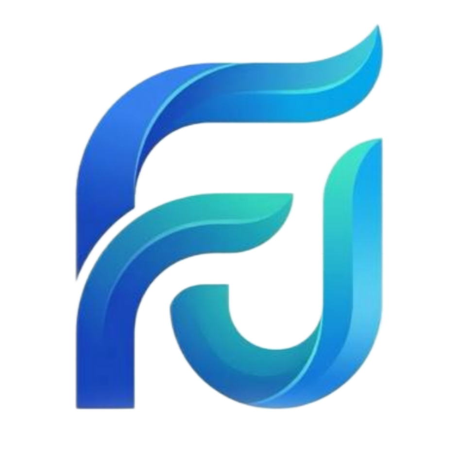

<p align="center">
  
</p>

<h1 align="center">FlexUI</h1>

<p align="center">
  <strong>Build Cinematic Interfaces.</strong><br/>
  182 animated React components. One command install. Zero lock-in.
</p>

<p align="center">
  <a href="https://flex-ui-wine.vercel.app"></a>
  
  
  
  
</p>

<p align="center">
  <a href="https://flex-ui-wine.vercel.app/docs">Docs</a> &nbsp;|&nbsp;
  <a href="https://flex-ui-wine.vercel.app/docs/components">Components</a> &nbsp;|&nbsp;
  <a href="https://flex-ui-wine.vercel.app/docs/installation">Installation</a> &nbsp;|&nbsp;
  <a href="https://flex-ui-wine.vercel.app/blog/flexui-registry-launch">Blog</a>
</p>

---

## What is FlexUI?

FlexUI is an **open-source component registry** built on the [shadcn/ui](https://ui.shadcn.com) protocol. Install production-ready components with spring-physics animations, WebGL 3D effects, and cinematic transitions — directly into your project with a single command.

**FlexUI is NOT an npm package.** Components are copied into your codebase. You own every line. No vendor lock-in. No version conflicts.

```bash
npx shadcn@latest add https://flex-ui-wine.vercel.app/r/magnetic-button.json
```

### Works with any React framework

<table>
  <tr>
    <td align="center"><strong>Next.js</strong></td>
    <td align="center"><strong>Vite</strong></td>
    <td align="center"><strong>React</strong></td>
  </tr>
  <tr>
    <td align="center">Works out of the box</td>
    <td align="center">Configure @/ alias</td>
    <td align="center">Any React 18+ setup</td>
  </tr>
</table>

---

## Quick Start

```bash
# 1. Init shadcn (if you haven't)
npx shadcn@latest init

# 2. Install a component
npx shadcn@latest add https://flex-ui-wine.vercel.app/r/magnetic-button.json

# 3. Use it
```

```tsx
import { MagneticButton } from "@/components/flexui/magnetic-button";

export default function App() {
  return <MagneticButton className="px-8 py-4">Get Started</MagneticButton>;
}
```

### Registry Setup (recommended)

Add FlexUI to your `components.json` for cleaner commands:

```json
"registries": {
  "@flexui": "https://flex-ui-wine.vercel.app/r/{name}.json"
}
```

Then install by name:

```bash
npx shadcn@latest add @flexui/magnetic-button
npx shadcn@latest add @flexui/spotlight-card
npx shadcn@latest add @flexui/page:saas-landing
```

---

## 182 Components Across 3 Tiers

### Tier 1 — Enhanced Primitives

Foundational components with polished animations and full accessibility.

| Component | Description |
|-----------|-------------|
| Magnetic Button | Spring-physics cursor tracking with spotlight glow |
| Shimmer Button | Animated shimmer sweep effect |
| Accordion | Spring-powered expand/collapse |
| Animated Tabs | Spring-animated active indicator |
| Toast | Stackable notifications with gestures |
| Badge, Avatar, Tooltip | Styled primitives with variants |
| Calendar, Color Picker | Interactive form components |
| Rating, Stepper, OTP Input | Data entry components |
| + 30 more | [Browse all Tier 1 →](https://flex-ui-wine.vercel.app/docs/components) |

### Tier 2 — Cinematic Blocks

Complex interactive components with spring physics and rich motion design.

| Component | Description |
|-----------|-------------|
| Spotlight Card | Cursor-tracking spotlight glow effect |
| Floating Panel | Glassmorphic panel with 12 composable parts |
| Morphing Dialog | Shape-morphing modal transitions |
| Dock Menu | macOS-style magnifying dock |
| Expandable Card | Spring-physics expand with direction control |
| Command Menu | Cmd+K palette with fuzzy search |
| Marquee | Infinite scroll marquee with hover pause |
| Parallax Scroll | Depth-layered scroll animation |
| Holographic Card | Rainbow refraction on tilt |
| + 50 more | [Browse all Tier 2 →](https://flex-ui-wine.vercel.app/docs/components) |

### Tier 3 — WebGL Experiences

GPU-accelerated, shader-driven, and immersive components.

| Component | Description |
|-----------|-------------|
| Interactive Globe | 3D world globe with animated arc connections |
| 3D Hover Card | Three.js scene with rotating geometry on hover |
| Cosmic Eye | GLSL shader eye with mouse-tracking pupil |
| Shader Blob | Real-time metaball with FBM noise |
| Particle Field | Configurable particle system |
| Neural Network | Animated neural network visualization |
| Splash Cursor | WebGL fluid cursor trail |
| Infinite Canvas | Pannable, zoomable infinite workspace |

### Page Templates

Complete pages installable with one command:

```bash
npx shadcn@latest add @flexui/page:saas-landing    # Full SaaS landing page
npx shadcn@latest add @flexui/page:pricing          # Pricing with comparison table
npx shadcn@latest add @flexui/page:dashboard        # Admin dashboard
npx shadcn@latest add @flexui/page:portfolio        # Developer portfolio
npx shadcn@latest add @flexui/page:ecommerce        # E-commerce storefront
npx shadcn@latest add @flexui/page:blog             # Blog layout
npx shadcn@latest add @flexui/page:auth-login       # Auth login page
```

---

## Why FlexUI?

| | Traditional UI Libs | FlexUI |
|---|---|---|
| **Ownership** | Black-box npm package | Source code in your project |
| **Animations** | Basic CSS transitions | Spring physics, WebGL, 3D effects |
| **Customization** | Override with `!important` | Edit the source directly |
| **Bundle size** | Import entire library | Only what you install |
| **Lock-in** | Version upgrades break things | No dependency to break |
| **Framework** | Often framework-specific | Next.js, Vite, any React |

---

## Animations That Work

Components that use CSS animations auto-install a `styles/flexui-animations.css` file with all required keyframes. Components that need the `useReducedMotion` accessibility hook get it bundled too. No manual setup — everything works after install.

---

## Component Studio

FlexUI Studio generates components, analyzes public websites, and creates themes using Gemini with a Groq fallback. Generated TSX runs in an isolated, opaque-origin iframe with a restricted Content Security Policy.

To run it locally:

```bash
python3 -m venv api/.venv
api/.venv/bin/python -m pip install -r api/requirements-dev.txt
# Set GEMINI_API_KEY and/or GROQ_API_KEY in api/.env (see api/env.example).
cd api
.venv/bin/uvicorn main:app --reload --port 8000
```

Run `npm run dev` separately. Development defaults to `http://localhost:8000`.
Production builds require `NEXT_PUBLIC_API_URL` pointing to your deployed API, and
`FRONTEND_URL` on the API must match the frontend origin. Never expose provider keys
through `NEXT_PUBLIC_` variables. The health endpoint reports configured providers;
missing configuration and provider failures appear as errors in Studio.

See [api/env.example](api/env.example) for optional provider model overrides. URL analysis
accepts public HTTP/HTTPS HTML pages on standard ports, limits responses to 2 MiB,
and validates and pins the destination address at every redirect.

---

## MCP Server — AI Integration

FlexUI ships with an MCP server for AI coding assistants. Ask Claude, Cursor, or Windsurf to add components directly.

```json
// Claude Desktop config
{
  "mcpServers": {
    "flexui": { "command": "npx", "args": ["-y", "@flexui/mcp-server"] }
  }
}
```

**4 tools available:** `list_components`, `get_component`, `search_components`, `add_component`

---

## Tech Stack

| Layer | Technology |
|-------|-----------|
| **UI** | React 18+ with TypeScript |
| **Styling** | Tailwind CSS v4 |
| **Animation** | Framer Motion + CSS Keyframes |
| **3D / WebGL** | Three.js, React Three Fiber, OGL |
| **Registry** | shadcn-compatible JSON protocol |
| **Docs** | Next.js 16 (189 static pages) |
| **CI/CD** | GitHub Actions + Vercel |
| **AI** | MCP Server (Claude, Cursor, Windsurf) |

---

## Run Locally

Use Node.js 22.12+ (or Node.js 24). The repository includes an nvm version file.

```bash
git clone https://github.com/tamilgithubid/flex-ui.git
cd flex-ui
npm ci
npm run dev
```

Open [http://localhost:3000](http://localhost:3000)

Before submitting a change, run:

```bash
npm run registry:build
npm test
npm run lint:ci
npx tsc --noEmit
npm run build
```

Registry tests check bundled imports, package dependencies, and fresh-consumer compilation.
CI requires a clean ESLint run with no errors or warnings. The previous lint baseline
has been removed. Browser tests exercise actual components and the generated-code
sandbox; screenshots are stored in `tests/browser/preview.spec.ts-snapshots`.

```bash
npx playwright install chromium
npm run test:visual
npm run build && npm run test:pages
# After reviewing an intentional visual change:
npm run test:visual:update
python -m pytest api/tests
```

The Figma plugin has its own lockfile and checks:

```bash
cd figma-plugin
npm ci
npm run typecheck
npm test
```

---

## Contributing

Contributions are welcome! Please open an issue or submit a pull request.

## License

MIT License. See [LICENSE](LICENSE) for details.

---

<p align="center">
  <strong>FlexUI</strong> — Build Cinematic Interfaces.<br/>
  <a href="https://flex-ui-wine.vercel.app">Live Demo</a> &nbsp;|&nbsp;
  <a href="https://flex-ui-wine.vercel.app/docs/installation">Get Started</a> &nbsp;|&nbsp;
  <a href="https://flex-ui-wine.vercel.app/blog/flexui-registry-launch">Read the Blog</a>
</p>


## Visual assets and motion checks

The blog, article covers, gallery and homepage card use local optimized artwork. See
[generated artwork](docs/generated-artwork.md) for asset paths and the prompt set.
`npm run test:pages` checks the production pages for headline transitions, card sizing,
image loading, responsive layout and the skull drawing-buffer budget. Build the app
before running these checks. Animation regression tests also check pointer updates,
shader reuse, visibility pauses and GPU cleanup.
